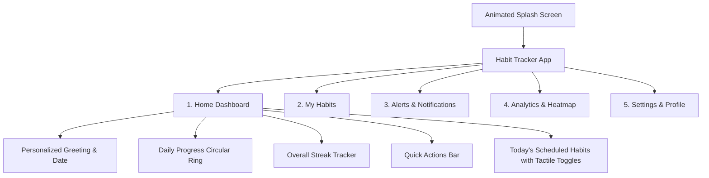

# 🌿 Habit Tracker — Full-Stack Personal Habit Tracker

A modern, full-stack personal habit tracker application with a modern emerald green & white theme, smooth animations, tactile haptic feedback, floating capsule navigation bar, intelligent reminders, comprehensive analytics, and seamless offline-first capability.

The application is **100% personal and private**: zero login, registration, or onboarding required. You open the app and immediately start tracking your habits with instant local persistence and optional background synchronization with a dedicated Node.js + Express + MongoDB backend.

---

## 🛠️ Technology Stack

| Component | Technology | Purpose |
| :--- | :--- | :--- |
| **Mobile Application** | **Flutter** (Dart 3) | Cross-platform native mobile application |
| **State Management** | **Flutter Riverpod** (2.5.1) | Reactive state management & dependency injection |
| **Haptic Feedback** | **HapticFeedback** | Tactile vibrations on tab switching, habit completion, and button presses |
| **Networking** | **Dio** (5.x) | Fast HTTP client with offline-first background synchronization |
| **Charts** | **fl_chart** | Real interactive bar charts, line trends, and calendar heatmaps |
| **Notifications** | **flutter_local_notifications** | Android local notification scheduling & reminders |
| **Local Storage** | **shared_preferences** | Instant offline persistence, starter habits, and installation scoping |
| **Backend Framework** | **Node.js + Express.js** | Modular RESTful API with centralized error handling |
| **Database** | **MongoDB** (Mongoose) | Document database with compound unique indexes |
| **Testing** | **Jest / Supertest / Flutter Test** | Comprehensive end-to-end API and widget test coverage |

---

## 🌟 Visual Theme & Design System

The application follows an **Emerald Green & Pure White** design philosophy:
- **Primary Color:** Emerald Green (`#10B981` / `#059669`)
- **Secondary Accent:** Vibrant Mint (`#34D399`) & Fresh Jade (`#047857`)
- **Background:** Crisp White-Mint (`#F7FAF8`) in Light Mode, Deep Obsidian Forest (`#0B1410` / `#12221B`) in Dark Mode
- **Cards:** Pure White elevated surfaces with softly rounded corners, subtle borders (`#E2EFE6`), and soft drop shadows
- **Streaks & Badges:** Forest and emerald badge accents with flame icons
- **Navigation Dock:** Floating capsule bottom bar with smooth active pill indicators and soft drop shadows
- **Typography:** Modern clean typography with high-contrast pine charcoal headings and sage secondary labels

---

## 🧭 The Five Main Screens



### 1. Animated Splash / Loading Screen
- Animated pulsing green aura with elastic logo expansion.
- "Habit Tracker" typography with smooth entrance transitions.
- Daily rotating motivational quotes from renowned thinkers.
- Seamless route transition directly into the main interface.

### 2. Home Dashboard
- Real-time daily progress ring updating immediately upon checking off habits.
- Streak summary card tracking current and longest streaks.
- Scheduled habits for today with instant completion checkboxes and progress bars.
- Quick actions bar for fast access to common tasks.
- Contextual motivational quotes based on daily completion rate.

### 3. My Habits
- Status filtering: **Active** vs **Archived**.
- Category filtering: Health, Fitness, Productivity, Mindfulness, Learning, Finance, Personal.
- Live search query filtering.
- Create / Edit habit modal with category selector, icon picker, color palette, measurable target values, and reminders.
- Detailed habit analytics with streak history, success rates, and archive/delete options.

### 4. Notifications & Alerts
- Local habit reminder alerts and streak milestone achievements.
- Unread badge indicator directly on the floating bottom navigation bar.
- Swipe to delete, mark all read, and instant system tray test notifications.

### 5. Statistics & Consistency Heatmap
- Timeframe filter: Weekly, Monthly, Yearly.
- 7-day daily completion rate bar chart.
- Multi-week consistency trend line chart.
- Habit-by-habit performance comparison breakdown.
- Month-by-month interactive calendar heatmap with intensity indicators.
- **Dedicated Habit Monthly History Screen**: Full chronological calendar from habit inception with green (completed) and white (uncompleted) day tiles.


### 6. Settings & Data Management
- Personal profile with editable display name.
- Theme Mode: Light, Dark, or System Default with instant cross-app update.
- Reminder and daily summary toggles.
- Full JSON backup export and import.
- Complete data wipe and reset functionality.

---

## 🚀 Running the Project

### Mobile Application (Flutter)
```bash
cd mobile
flutter pub get
flutter run
```

To build the release APK:
```bash
flutter build apk --release
```
The output APK will be generated at:
`mobile/build/app/outputs/flutter-apk/app-release.apk`

### Backend Server (Node.js)
```bash
cd backend
npm install
npm run dev
```

The backend server will run on `http://localhost:5000` with full health checks at `/api/health`.
